  
  

I'm a fullstack developer in Vietnam with a frontend background. I build the interface in React/Next.js and the API behind it in Node.js/NestJS, and I care most about the parts users never see until they break: auth, permissions and data models.

<table>
  <tr><td><b>Role</b></td><td>Fullstack developer (frontend first, backend close behind)</td></tr>
  <tr><td><b>Home</b></td><td>Vietnam · UTC+7</td></tr>
  <tr><td><b>Focus</b></td><td>Auth flows, multi-tenant APIs, clean module boundaries</td></tr>
  <tr><td><b>Ask me about</b></td><td>React, Next.js, NestJS, JWT/OAuth, MongoDB</td></tr>
</table>

<table>
  <tr><td><b>Languages</b></td><td></td></tr>
  <tr><td><b>Frontend</b></td><td></td></tr>
  <tr><td><b>Backend & data</b></td><td></td></tr>
  <tr><td><b>Tooling</b></td><td></td></tr>
</table>

<table>
  <tr>
    <td width="50%" valign="top">
      <h3><a href="https://github.com/Gressi-177/ecommerce-backend-nodejs">ecommerce-backend</a></h3>
      
Multi-vendor commerce API: API-key auth, JWT access and refresh tokens with rotation and reuse detection, per-shop catalog with draft/publish, inventory and discounts.

      
<code>Node.js</code> <code>Express</code> <code>MongoDB</code> <code>JWT</code>

    </td>
    <td width="50%" valign="top">
      <h3><a href="https://github.com/Gressi-177/nestjs-base">nestjs-base</a></h3>
      
A NestJS starting point with Google OAuth, JWT auth and a commit pipeline (Husky, lint-staged, commitlint) so checks run before code lands.

      
<code>NestJS</code> <code>TypeScript</code> <code>OAuth</code>

    </td>
  </tr>
  <tr>
    <td width="50%" valign="top">
      <h3><a href="https://github.com/Gressi-177/Shopee">shopee-clone</a></h3>
      
Storefront UI: product list with filters, sort and pagination, product detail, auth and profile pages, server state with React Query.

      
<code>React</code> <code>TypeScript</code> <code>React Query</code> <code>Tailwind</code>

    </td>
    <td width="50%" valign="top">
      <h3><a href="https://github.com/Gressi-177/TranslationApp_RN">translation-app</a></h3>
      
Team project: translate by camera (OCR) or voice, with history and favorites. Expo client plus a <a href="https://github.com/Gressi-177/TranslationApp_BE">FastAPI backend</a> running EasyOCR and speech-to-text.

      
<code>React Native</code> <code>Expo</code> <code>FastAPI</code>

    </td>
  </tr>
</table>

  
  

  

- Own a feature end to end: data model → API → UI.
- Treat auth and permissions as product requirements, not an afterthought.
- Prefer clear module boundaries over clever abstractions.

