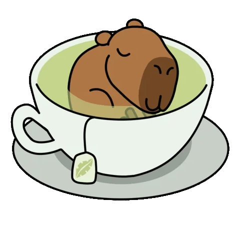
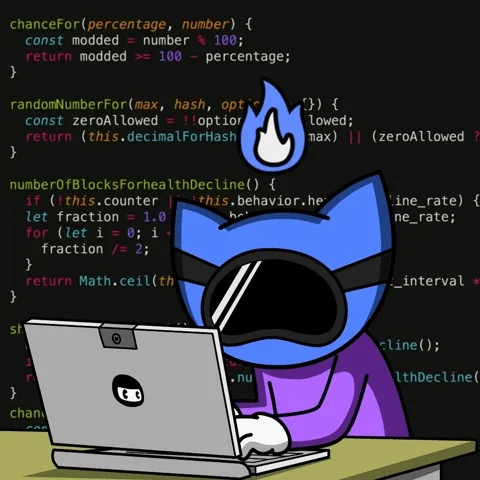

   <h1>Hi there, I'm <a href="https://portfolio-viet-doans-projects.vercel.app">Asmodeus</a>  </h1>

    <h3>
        
        👩‍💻 Doan Tran | 💻 Frontend Developer Developer | 🛸 VietNam 
        
    </h3>

<h5 align="center">
   <i>⚡️Programming: The art of turning coffee into code... and bugs into features!⚡️</i>
</h5>
 
 

  <h3>Frontend Developer from Vietnam, code is life.</h3>

- 🥀 Javascript, Typescript, React are my best friends, can't live without them!

- 💻 Passionate about coding to the point where I can't breathe without it – it's like oxygen!

- 🎬 Love watching movies, especially those with mind-blowing plot twists!

- 🎮 Other hobby: Gaming for fun (only when I need to "reset" my brain).

- Fullstack by day, living life to the fullest, because there's no such thing as "bugs" in life!

- 💬 Let's connect, share knowledge, and geek out over tech!

- Fall down? Just chill there for a bit, then get back up! 😆💪

### - Languages and Tools...

  

